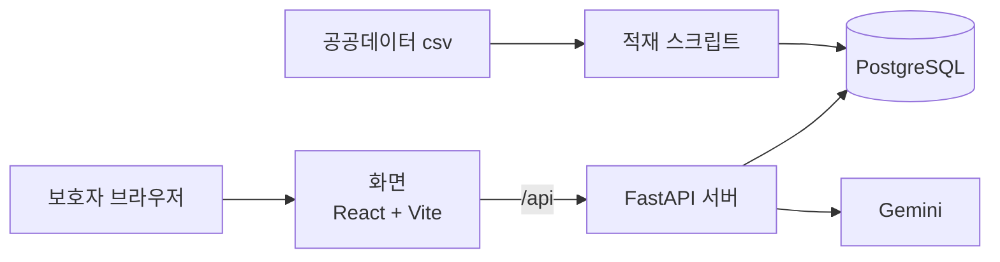

# 발자국

반려견이 갈 수 있는 곳을 공공데이터로 추려, 여행 코스를 대화로 짜 주는 AI 여행 플래너입니다.

프로젝트 소개: https://balzaguk.jangminseok.com

제4회 문화체육관광 인공지능·데이터 활용 공모전에 4인 팀으로 참가해 10일 동안 만들었습니다. 제출 때는 화면을 Vercel에, 서버를 Railway에 올렸습니다. 지금은 서버가 내려가 있어 시연할 수 없습니다.

## 한눈에 보기

| 항목 | 내용 |
| --- | --- |
| 기간 | 2026년 6월 17일 ~ 6월 26일 |
| 인원 | 4명 |
| 내가 맡은 일 | 풀스택으로 서버, AI 대화 기능, 공공데이터와 DB, 배포를 맡고 배포한 앱의 화면도 만들었습니다. |
| 주요 기술 | Python 3.13, FastAPI, SQLAlchemy 2, Alembic, PostgreSQL(Neon), Gemini, pandas, pyproj, React 19, Vite, Docker, Railway, Vercel, 네이버 지도 |

팀원이 따로 만든 홍보용 메인 페이지와 플래너, 응급 안내 화면은 별도 브랜치에 있고 main 브랜치에는 합쳐지지 않았습니다.

## 주요 기능

- **대화로 여행 일정 짜기**: 어디로 갈지, 무엇을 타고 갈지, 자고 올지를 AI가 차례로 묻고, 세 가지가 정해지면 코스를 만듭니다. 마이크 버튼으로 말로도 답할 수 있습니다.
- **들어갈 수 있는 곳으로만 코스 추천**: 반려견의 크기로 입장할 수 있는 시설만 후보로 고르고, AI는 그 후보 안에서 순서를 정합니다.
- **장소별 입장 가능 여부 확인**: 들어갈 수 없는 곳이면 같은 지역에서 받아 주는 가까운 곳을 3곳까지 대신 보여 줍니다.
- **응급 상황 안내**: 증상을 말하면 짐작되는 원인과 긴급도를 알려 주고, 가까운 영업 중 동물병원 5곳을 함께 보여 줍니다. 진단이 아닌 참고용입니다.
- **공공데이터 적재**: 기관마다 형식이 다른 파일을 한 기준으로 맞춰 담았습니다. 시설 30,417곳, 입장 가능 크기 88,678건, 동물병원 9,299곳이 들어갔습니다(2026년 6월 26일 적재 후 DB 조회 기준).

## 구조

서버가 DB에서 갈 수 있는 시설을 먼저 추리고, AI는 그 명단 안에서 번호로만 순서를 고릅니다. AI가 답하지 못하면 가까운 곳부터 잇는 규칙이 대신 코스를 만듭니다.



## AI 활용과 확인

- 대화형 플래너로 방향을 바꿀 때 Claude Code에 맡길 작업 지시서를 먼저 썼습니다. 만드는 순서, 외부 서비스 없이도 끝까지 도는 모의 데이터 경로, 비밀키를 저장소에 올리지 않는 규칙을 적었습니다.
- 자동 테스트는 사용자 모듈에 10개가 있습니다. 나머지는 주소를 직접 호출해 보고, 타입 검사와 빌드를 돌리고, 브라우저 자동화 도구로 화면을 확인했습니다.
- AI가 돌려준 번호는 코드가 후보 명단과 다시 대조하고, 명단에 없는 번호는 버립니다.

## 시작하기

서버는 DB 없이도 켜지지만, 이때는 시설 데이터가 없어 코스가 비어서 나옵니다.

```bash
cd adapdog
pip install -r requirements.txt
uvicorn main:app --port 8000
python -m pytest            # 테스트 10개
```

시설 추천까지 보려면 `adapdog/.env.example`을 `.env`로 복사해 `DATABASE_URL`(PostgreSQL)을 채우고, `alembic upgrade head`로 표를 만든 뒤 `scripts/ingest_*.py`로 `csv/`의 공공데이터를 적재합니다. Gemini 키가 없으면 규칙 기반 코스로 대신합니다.

```bash
cd www
npm install
npm run dev                 # http://localhost:3000, /api는 8000번 서버로 넘깁니다
```

## 폴더 구조

```
adapdog/        FastAPI 서버
  apps/         기능별 모듈 (map 코스와 지도, care 응급 안내, trips 여행, users 회원과 반려견)
  core/         설정과 DB 연결
  alembic/      DB 마이그레이션
  scripts/      공공데이터 적재 스크립트
  tests/        사용자 모듈 테스트
www/            React + Vite 화면 (src가 지금 화면, _legacy_src는 빌드에 쓰지 않는 이전 코드)
csv/            적재에 쓰는 공공데이터 원본
_docs/          ERD, 시나리오, 활용 데이터 목록 등 설계 문서
Dockerfile      화면과 서버를 이미지 하나로 묶는 배포용 빌드
```
